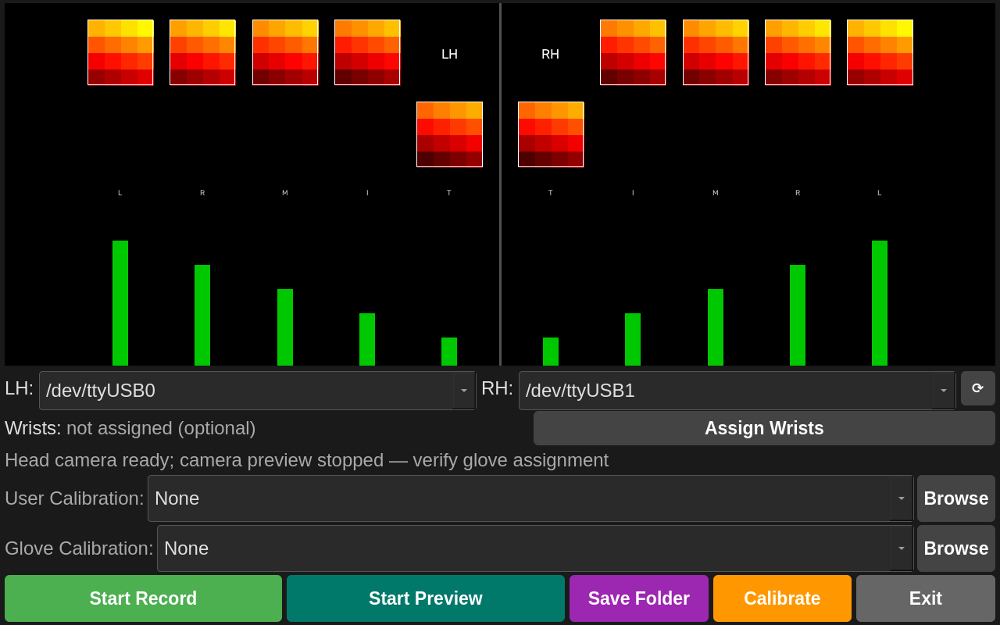
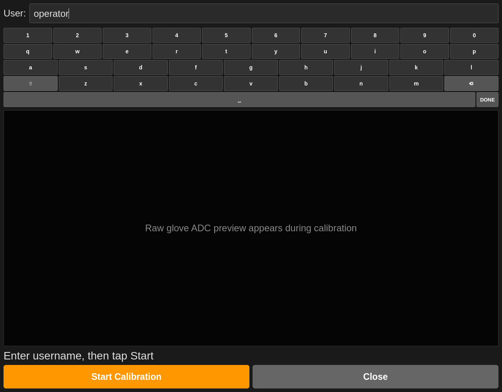
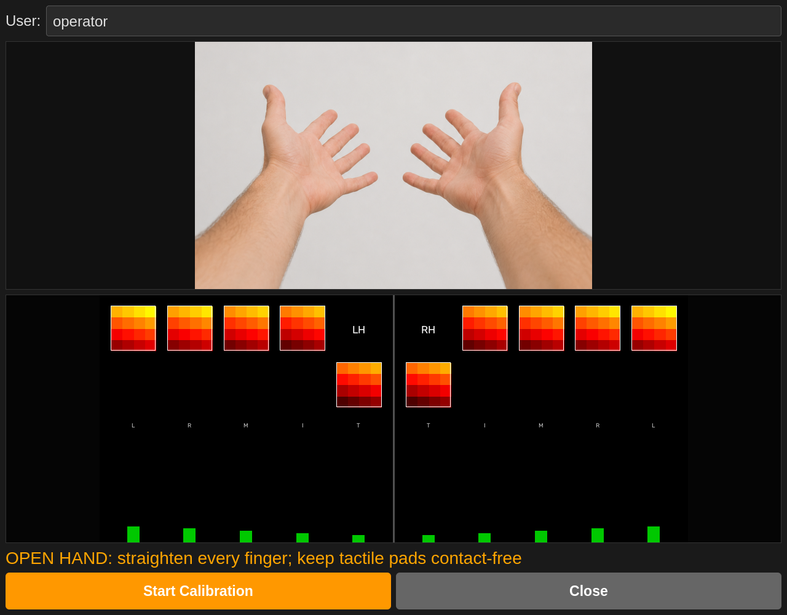
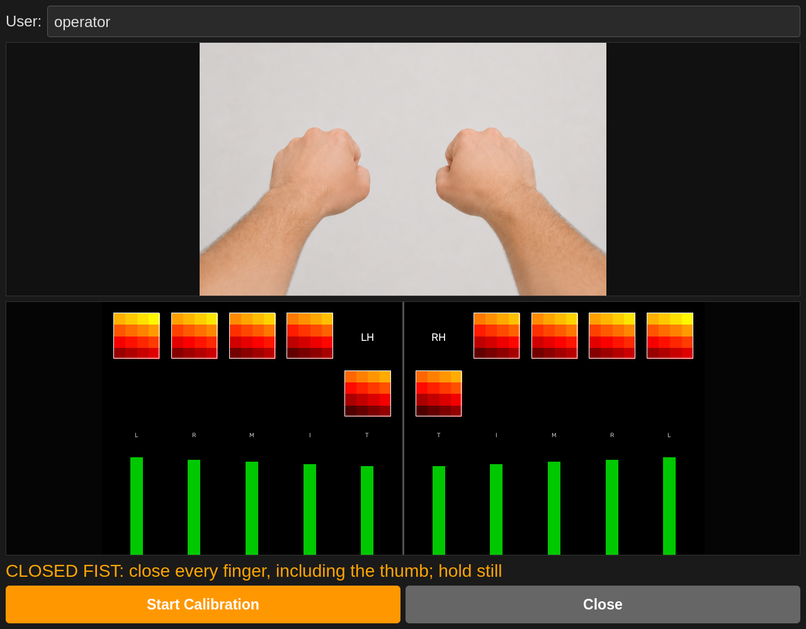
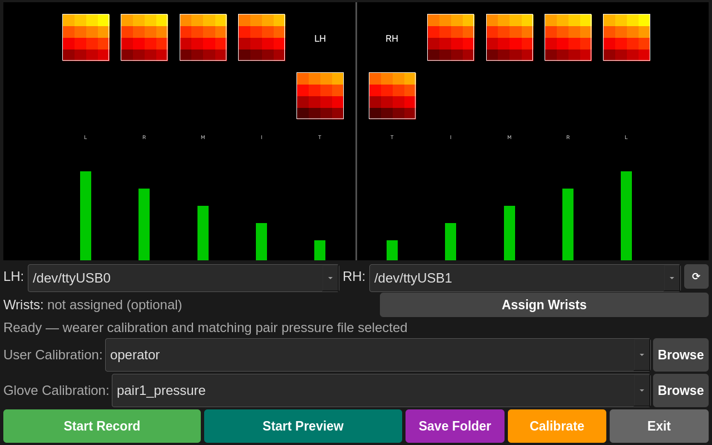
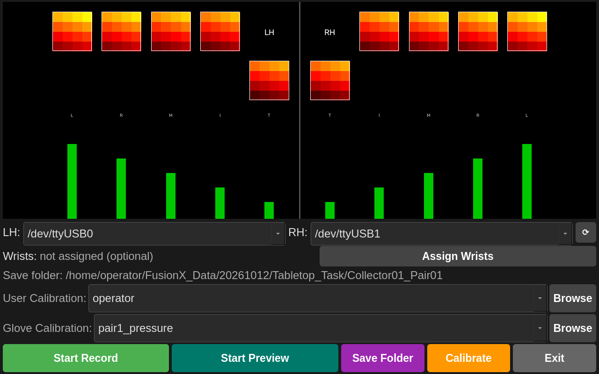
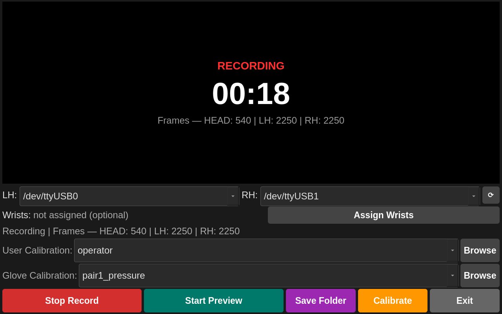
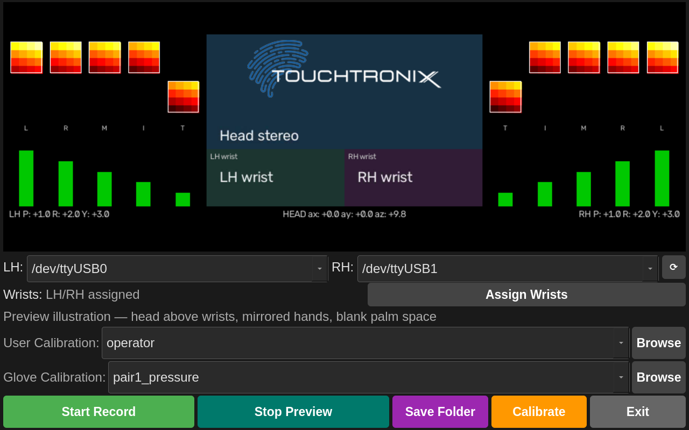
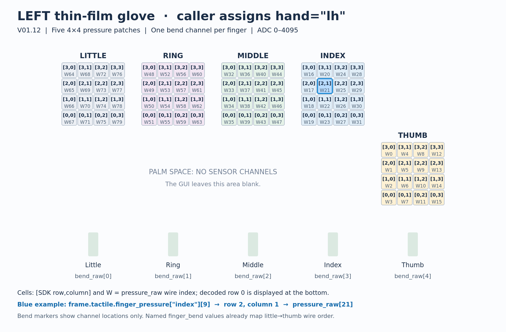
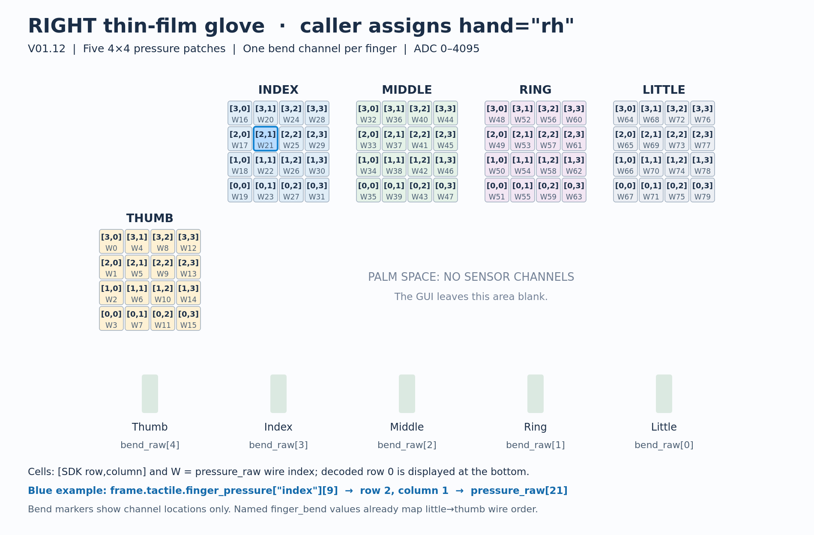

# TouchTronix FusionX Data Collection & Glove SDK

GUI recording instructions, Python API examples, and sensor diagrams for **V3 thin-film tactile gloves**, using the current **V01.12** wired format.

This branch is **`v3-thimfilm`**. It documents five **4×4** finger patches and five bend channels, a required Arducam head stereo camera, and up to two optional wrist cameras. The branch name identifies the glove configuration; it is independent of the SDK version and MCAP profile.

- [GUI data collection guide](#gui-data-collection-guide) — select ports, calibrate, record, and inspect files.
- [SDK quick start](#sdk-quick-start) — stream one or two explicitly assigned gloves.
- [SDK Python API](#sdk-python-api) — reader methods, returned fields, units, and timestamps.
- [Glove sensor diagrams](#glove-configuration-locate-an-sdk-value) — locate a pressure or bend reading.
- [Calibration reference](docs/calibration.md), [SDK API reference](docs/sdk-api.md), [MCAP recording format](docs/recording-format.md), and [compatibility/troubleshooting](docs/compatibility.md).

Earlier conductive-fabric instructions remain on [v1-conductive-fabric](https://github.com/TouchTronix-Robotics/FusionX-DataCollection/tree/v1-conductive-fabric) and [v2-conductive-fabric](https://github.com/TouchTronix-Robotics/FusionX-DataCollection/tree/v2-conductive-fabric). Their SDKs, glove formats, and calibration files do not apply to V3.

## Daily use and maintenance

- Contact TouchTronix support for product issues or damaged sensors/cables. Do not disassemble the glove without authorization.
- Keep sharp objects away from the sensor patches and avoid pulling the cables forcefully.
- Inspect the glove and connections before a session; stop using damaged equipment.
- Clean the surface with a soft, dry cloth and avoid corrosive solvents.
- Avoid excessive pressure on the main control board.

## GUI data collection guide

The five steps below follow the same workflow as the V2 guide, updated for thin-film gloves and the current GUI.

### Before you start

Obtain the **V3 thin-film GUI package**, license key, and matching glove-pair calibration from TouchTronix. Public application releases, when published, are listed under [Releases](https://github.com/TouchTronix-Robotics/FusionX-DataCollection/releases); choose a package explicitly intended for this configuration. The V2 v2.2.0 application is for the older glove configuration. This documentation branch does not install the recording application.

- **Windows:** extract the entire ZIP, then open `touchtronix-fusionX.exe`. Keep `_internal/` beside it.
- **Linux:** use a desktop with FUSE 3, mark the AppImage executable, and launch it as your normal user. It includes its Python runtime and application dependencies.
- Connect the head stereo camera and the glove(s) to record. Close other programs using them.
- Connect optional wrist cameras before launching. Assign one wrist to LH or RH, or assign both; two wrists are not required.
- Create a destination folder on persistent storage with enough space for video.

Example Linux launch; replace `<version>` with the version of the package supplied to you:

```bash
chmod +x touchtronix-fusionX-<version>-linux-x86_64.AppImage
./touchtronix-fusionX-<version>-linux-x86_64.AppImage
```

The default `dataset/` and `calibrations/` folders live beside the application or AppImage. **Save Folder** and **Browse** select other locations. Enter your license key when prompted; activation is stored under `~/.config/touchtronix/license.json`.

The screenshots below are **illustrations rendered from the current GUI with example ports, filenames, and simulated readings**. They are not evidence of a physical recording session. Windows uses the same controls; native pickers and serial-port names differ.

### 1. Select the left and right glove ports

Choose the physical left glove in **LH** and the right glove in **RH**. Use the circular-arrow button to refresh the port list. Do not select the same port for both hands.

| Control | Linux example | Windows example |
|---|---|---|
| **LH** | `/dev/ttyUSB0` | `COM3` |
| **RH** | `/dev/ttyUSB1` | `COM4` |

Port numbering and USB adapter identifiers do not establish handedness. Touch one glove at a time and confirm that the correct **LH/RH raw heatmap** responds. These tactile/bend previews remain available while idle when camera preview is stopped.



The head camera is detected automatically. Allow startup and head IMU preparation to finish. **Assign Wrists** uses live thumbnails to tag optional cameras, whose reported serial numbers can be identical. The app discovers camera identities once per launch: restart after adding a camera or moving one to a different physical port.

### 2. Run the user calibration

Click **Calibrate**, enter a username, and click **Start Calibration**. There are exactly two poses:

1. **Open palm / open hand:** wear the gloves, straighten all fingers, and avoid contact or pressure on the tactile pads. Hold through the collection cue. This records resting tactile values and open-hand bend readings.
2. **Closed fist:** close every finger, including the thumb, and hold through the collection cue. This records the closed-fist bend endpoint, not a pressure maximum.

Wait for completion, then click **Close**. Use a new username to preserve an existing file; selecting an existing wearer file intentionally replaces that wearer's calibration when rerun.



| Open hand | Closed fist |
|---|---|
|  |  |

The wearer calibration is saved as JSON in `calibrations/`. Renew it whenever the gloves are put on again or the wearer/session changes. The contact-free pressure baseline is a per-pixel median over the final second of the open pose. See the [calibration reference](docs/calibration.md).

### 3. Select the user and glove calibrations

| Selector | Choose |
|---|---|
| **User Calibration** | The current wearer's V01.12 JSON created in step 2. |
| **Glove Calibration** | The supplied pressure or polynomial force JSON for this physical glove pair. |



**Browse** beside either selector opens the native file picker. Files can live outside the application folder. V1/V2 and earlier four-finger calibrations are incompatible; regenerate wearer calibration for all five current finger patches.

Calibrated pressure/force requires both the wearer calibration and the matching glove-pair file. Raw tactile/bend readings are still preserved. The supplied `calibrations/example_perpixel_pressure.json` is specifically for **LH_1/RH_1** and contains pressure in **kPa**, not force in newtons. Do not swap those physical gloves or apply their tables to another pair.

### 4. Choose where recordings are saved

Click **Save Folder**, choose the final session directory, and confirm the operating system's picker. The status line and button tooltip show the destination.



For example, select the last folder in this structure:

```text
FusionX_Data/
  20261012/
    Tabletop_Task/
      Collector01_Pair01/
```

The app writes directly into the selected folder. **Save Folder chooses the destination; it does not start recording.**

### 5. Start and stop data collection

Check the hand assignments, calibrations, and destination, then click **Start Record**. Wait for **Recording** and increasing counters before starting the task. The head video, head IMU, and factory head calibration are required; selected wrist streams must also become ready. Startup failure leaves no recording files for that attempt.

Click **Stop Record** and wait for **Saved** before opening files or disconnecting devices. **Space** also starts/stops from the main window, except while typing or using child dialogs.



Camera preview starts automatically after preparation. **Stop Preview** reduces display/decoding work, while **Start Preview** restores it. Toggling preview does not stop recording or camera capture. The GUI keeps the familiar arrangement: mirrored hands beside the head stereo view, with LH/RH wrist views underneath. Four upper finger pads and a lower inner thumb use the current 4×4 geometry; the palm space remains blank. Bend bars align with the finger columns.



Finished files are numbered directly in the chosen folder:

```text
Collector01_Pair01/
  recording_000.mcap
  recording_001.mcap
  ...
```

Segments rotate after 9,000 head frames on the next head keyframe, approximately five minutes at 30 FPS. Each segment starts with independently playable camera data. Another recording uses the next unused index, preserving earlier files.

### Inspect recordings in Foxglove

1. Install [Foxglove Desktop](https://foxglove.dev/download). Local files, layout authoring, and local extensions require the capabilities of a [developer seat](https://docs.foxglove.dev/docs/security/seat-types).
2. Download [FusionX Tactile 0.6.0](https://raw.githubusercontent.com/TouchTronix-Robotics/FusionX-DataCollection/refs/heads/v3-thimfilm/touchtronixrobotics.fusionx-tactile-panel-0.6.0.foxe) and the [V3 layout](https://raw.githubusercontent.com/TouchTronix-Robotics/FusionX-DataCollection/refs/heads/v3-thimfilm/fusionx_foxglove_layout.json).
3. Open or drag the `.foxe` into Foxglove and reload. Install it **before** importing the layout.
4. Choose **Layouts → Import from file…** and select `fusionx_foxglove_layout.json`.
5. Open the finished `recording_###.mcap` files, then play or scrub the timeline.

The layout includes three camera panels, the two-hand FusionX Tactile panel, head acceleration/gyro plots, and glove IMU plots. The panel offers **Raw ADC** and **Pixel pressure**; pressure is available only when the recording contains the calibrated pressure/saturation fields. Pressure uses 0–345 kPa, and amber outlines identify saturated pixels. The raw view and its five bend bars preserve 0–4095 ADC values.

Use [Data Source Info](https://docs.foxglove.dev/docs/visualization/panels/data-source-info) for topic counts/time range and Raw Messages for exact fields. Head stereo video remains side by side; wrist IMU topics are absent. Glove Euler angles are available, but raw gyro/accelerometer units are unverified. See the [MCAP reference](docs/recording-format.md).

## SDK quick start

TouchTronix supplies matching compiled wheels privately. This branch contains SDK examples and documentation, **not SDK wheels**. This API documentation targets SDK **0.5.0**; request a matching validated wheel for **CPython 3.13**, your OS, and x86_64 architecture. A `cp313` wheel cannot be installed into Python 3.12 or 3.14. The GUI already contains its Python runtime; the following environment is for independent SDK use.

Linux, from the directory containing your supplied wheel:

```bash
python3.13 -m venv .venv
source .venv/bin/activate
python -m pip install ./tactile_glove_sdk-0.5.0-cp313-cp313-linux_x86_64.whl
git clone --single-branch --branch v3-thimfilm https://github.com/TouchTronix-Robotics/FusionX-DataCollection.git
cd FusionX-DataCollection
python examples/stream_glove.py --left /dev/ttyUSB0 --right /dev/ttyUSB1 --viewer
```

Windows PowerShell:

```powershell
py -3.13 -m venv .venv
.\.venv\Scripts\Activate.ps1
python -m pip install .\tactile_glove_sdk-0.5.0-cp313-cp313-win_amd64.whl
git clone --single-branch --branch v3-thimfilm https://github.com/TouchTronix-Robotics/FusionX-DataCollection.git
cd FusionX-DataCollection
python examples/stream_glove.py --left COM3 --right COM4 --viewer
```

Use the ports for your gloves. One glove also works:

```bash
python examples/stream_glove.py --right /dev/ttyUSB1 --viewer
python examples/stream_glove.py --left /dev/ttyUSB0 --seconds 30
python examples/read_one_frame.py /dev/ttyUSB1 --hand rh
python examples/test_glove.py /dev/ttyUSB1 --hand rh
```

The viewer has five 4×4 tactile patches and five raw bend bars per hand. Each selected port has its own acquisition worker; 25 FPS display refresh consumes only the latest readings and does not set the sensor rate. Close the window, press Ctrl+C, or use `--seconds` to stop and close ports. Reader/rendering errors are reported after cleanup. These examples do not require cameras, MCAP, or Foxglove.

## SDK Python API

The package is `tactile_glove`. Use one synchronous reader per serial port and one consumer per reader. The SDK starts no acquisition thread; the streaming/viewer example supplies one worker per selected port.

```python
from tactile_glove import GloveReader

# Hand comes from this explicit assignment, not the device or port order.
with GloveReader("/dev/ttyUSB1", hand="rh") as glove:
    frame = next(glove.stream())
    print(frame.hand)  # "rh"
    print(frame.tactile.finger_pressure["index"][9])  # row 2, column 1
    print(frame.tactile.finger_bend["little"])  # raw bend ADC
    print(frame.imu.euler_deg)  # pitch, roll, yaw in degrees
    print(frame.host_timestamp_ns, frame.device_timestamp_ms)
```

### Reader configuration and methods

```python
reader = GloveReader(port="COM3", hand="lh", baudrate=1_000_000)
```

| Argument | Type / default | Meaning |
|---|---|---|
| `port` | Required `str` | One explicit Linux device path or Windows COM port. Create a separate reader for each glove. |
| `hand` | `str`, `"lh"` | Caller-assigned `"lh"` or `"rh"`; ports and device packets do not identify the hand. |
| `baudrate` | `int`, `1_000_000` | V01.12 wired connection speed, with 8 data bits, no parity, and one stop bit. |

| Method / usage | Result and behavior |
|---|---|
| `connect()` | Opens the port, stops any stale stream, queries firmware/battery, then starts combined samples. Connecting again restarts the connection and glove time counter. |
| `disconnect()` | Stops streaming, closes the port, and clears pending input. Repeated calls are safe. |
| `read_frame()` | Returns one complete `GloveFrame`, or `None` while waiting for a complete valid packet. It can block briefly on a serial read. |
| `stream()` | Iterator yielding every accepted complete frame, skipping `None` results without resampling. |
| `with GloveReader(...) as glove:` | Connects on entry and disconnects on exit, including exceptions or Ctrl+C. |

Reading before connecting raises `RuntimeError`; an unsupported hand raises `ValueError`. Port/open/read errors propagate as serial exceptions. Two seconds without a valid combined sample after starting or after the last accepted sample raises `TimeoutError`; metadata and malformed packets do not reset that deadline. The SDK does not reconnect automatically. To recover, disconnect and reconnect explicitly, then create a new `stream()` iterator if the previous one raised.

### Returned fields

Every accepted frame contains both tactile and IMU data. Import the data types with `from tactile_glove import GloveFrame, TactileData, IMUData`.

| Field | Python type / shape | Meaning |
|---|---|---|
| `frame.hand` | `str` | Your `"lh"` or `"rh"` assignment. |
| `frame.host_timestamp_ns` | `int` | Unix host time in nanoseconds when the valid packet is decoded. |
| `frame.device_timestamp_ms` | `int` | Glove-generated elapsed stream time in milliseconds. |
| `frame.tactile.finger_pressure` | `dict[str, list[int]]`; five lists of 16 values | All 80 pressure ADC readings, in named row-major 4×4 patches. |
| `frame.tactile.finger_bend` | `dict[str, int]`; five values | One raw bend ADC reading per finger. |
| `frame.imu.euler_deg` | `tuple[float, float, float]` | `(pitch, roll, yaw)` in degrees, preserving the device convention. |
| `frame.imu.gyro_raw` | `tuple[int, int, int]` | Signed 16-bit `(x, y, z)` gyroscope readings. |
| `frame.imu.accel_raw` | `tuple[int, int, int]` | Signed 16-bit `(x, y, z)` accelerometer readings. |

`FINGER_NAMES` is `["thumb", "index", "middle", "ring", "little"]`; `ADC_MAX` is **4096**. Pressure and bend values retain their native **0–4096** range. Access a pressure pixel as `frame.tactile.finger_pressure[finger][4 * row + column]`, where row and column are 0–3. The SDK returns raw ADC values and does not load calibration files or produce calibrated force, pressure, or bend angles.

The two timestamps are separate clocks. The unsigned 32-bit `device_timestamp_ms` starts at zero whenever streaming starts, including reconnects, and represents up to 4,294,967,295 ms (about 49.71 days). Firmware overflow behavior remains unverified. Healthy V01.12 output measured 8 ms between samples (125 Hz); this is an observed output rate. Host timestamps can include serial buffering and processing delay. Convert host nanoseconds to seconds with `frame.host_timestamp_ns / 1_000_000_000`.

The glove's raw gyroscope/accelerometer scaling and usable output remain unverified: inspected V01.12 samples returned zeros for those fields. The SDK preserves raw Euler angles without hand-dependent sign changes; no quaternion is transmitted.

SDK 0.5.0 removes `message_sequence`, `tactile.pressure_raw`, `tactile.bend_raw`, `tactile.raw_bytes`, and `imu.raw_bytes` from the public API. All 85 tactile/bend channels remain in the named finger fields. This change applies to the SDK API; the application recording format is described separately in the [MCAP reference](docs/recording-format.md). See the [full SDK API reference](docs/sdk-api.md) for further details.

## Glove configuration: locate an SDK value

The diagrams show the GUI's mirrored hand silhouette, current 4×4 patches, and corresponding wire indices. Cell labels use SDK `[row,column]`, with the first decoded row displayed at the bottom. Each `W` label is a zero-based pressure wire-channel index, provided for physical mapping. The palm area has no sensor channels.

### Left glove — caller assigns `hand="lh"`



### Right glove — caller assigns `hand="rh"`



For a decoded patch, use `frame.tactile.finger_pressure[finger][4 * row + column]`. The wire relationship is:

```text
wire_index = 16 * finger_index + 4 * column + (3 - row)
finger_index: thumb=0, index=1, middle=2, ring=3, little=4
```

Pressure wire blocks are thumb → little. The five raw bend values are in the opposite order, little → thumb; named `finger_bend` fields already map them to the correct fingers. All 80 pressure and five bend channels are preserved. There is no second bend sensor per finger, palm array, dorsal bend field, or transmitted quaternion in this API.

## Serial access and troubleshooting

On Linux, inspect your actual ports and access groups:

```bash
ls -l /dev/ttyUSB* /dev/ttyACM* 2>/dev/null
groups
```

For a device owned by `dialout` on Ubuntu, an administrator can grant group access:

```bash
sudo usermod -aG dialout "$USER"
```

Log out and back in before retrying. Other distributions may use `uucp`. Avoid `sudo python`, which can bypass the selected environment and run the application as root. On Windows, inspect COM ports in Device Manager and use the hardware vendor's serial driver.

For head-camera IMU or factory calibration errors on Linux, video-device access is insufficient: the app also needs scoped access to the head camera's `/dev/bus/usb/...` device. Ask an administrator to authorize that device and restart the app; wrist cameras need video access only. More checks are in [compatibility and troubleshooting](docs/compatibility.md).
