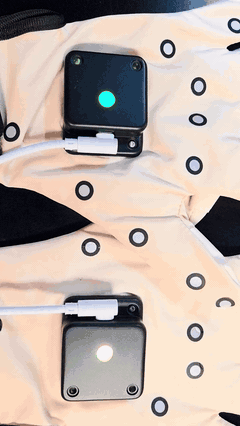

# TouchTronix FusionX documentation

**V3 thin-film gloves · V01.12 firmware · `v3-thimfilm`**

Each glove has five 4×4 pressure patches and five bend channels.

## Enable glove communication mode

**Press and hold the button on each glove until its yellow indicator light starts flashing.** This enables communication mode so the GUI or SDK can receive data.

## Download v3.0.0

[Release notes and all downloads](https://github.com/TouchTronix-Robotics/FusionX-DataCollection/releases/tag/v3.0.0)

| Package | Windows x86_64 | Linux x86_64 | Linux ARM64 |
|---|---|---|---|
| FusionX GUI, with Python runtime | [Windows ZIP](https://github.com/TouchTronix-Robotics/FusionX-DataCollection/releases/download/v3.0.0/touchtronix-fusionX-v3.0.0-windows-x86_64.zip) | [Linux AppImage](https://github.com/TouchTronix-Robotics/FusionX-DataCollection/releases/download/v3.0.0/touchtronix-fusionX-v3.0.0-linux-x86_64.AppImage) | — |
| Glove SDK 0.6.0, for CPython 3.13 | [Windows wheel](https://github.com/TouchTronix-Robotics/FusionX-DataCollection/releases/download/v3.0.0/tactile_glove_sdk-0.6.0-cp313-cp313-win_amd64.whl) | [Linux wheel](https://github.com/TouchTronix-Robotics/FusionX-DataCollection/releases/download/v3.0.0/tactile_glove_sdk-0.6.0-cp313-cp313-linux_x86_64.whl) | [ARM64 wheel](https://github.com/TouchTronix-Robotics/FusionX-DataCollection/releases/download/v3.0.0/tactile_glove_sdk-0.6.0-cp313-cp313-linux_aarch64.whl) |

GUI recording requires a TouchTronix license and supported Arducam head camera. Calibrated output requires the matching glove-pair file.

The ARM64 SDK requires glibc 2.28+ and 64-bit CPython 3.13. The SDK includes terminal wearer calibration and the GUI's English/Chinese WAV cues and beeps. Install the optional `audio` extra for miniaudio playback or `viewer` for the live display; headless acquisition and calibration work without GUI libraries. See [SDK setup](docs/sdk/README.md).

## Choose your workflow

| Guide | Collect |
|---|---|
| [FusionX GUI](docs/gui/README.md) | Gloves, head stereo/IMU, and optional wrist video to MCAP. |
| [Glove SDK](docs/sdk/README.md) | Terminal wearer calibration, glove samples, and calibrated pressure/force in your own Python pipeline. |

## Daily use and maintenance

- Wipe with a soft, dry cloth; avoid sharp objects and solvents.
- Avoid cable strain or heavy pressure on the control board. Stop using damaged hardware.
- Contact TouchTronix for repairs; do not disassemble the glove.

## Earlier glove configurations

[V1](https://github.com/TouchTronix-Robotics/FusionX-DataCollection/tree/v1-conductive-fabric) · [V2](https://github.com/TouchTronix-Robotics/FusionX-DataCollection/tree/v2-conductive-fabric). V3 needs its own SDK and calibration files.
