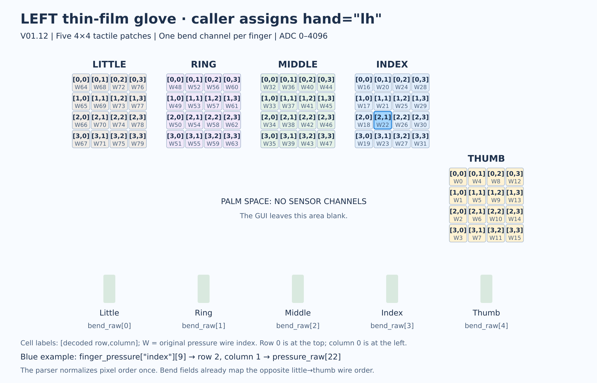
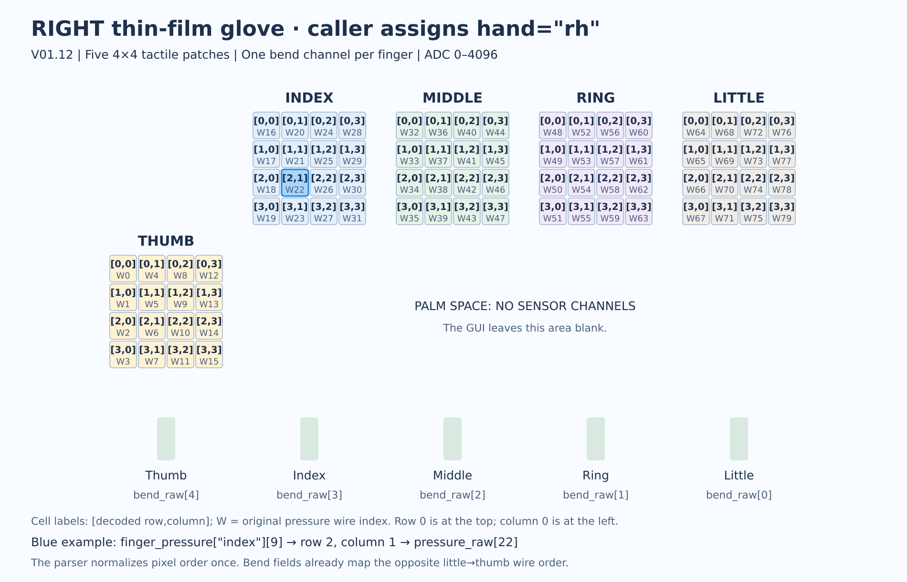

# Glove sensor layout and indexing

[SDK guide](README.md) · [Python API](api.md) · [Troubleshooting](troubleshooting.md)

Five 4×4 patches, one bend channel per finger, no palm channels. Diagrams label SDK `[row,column]` and zero-based wire index `W`.

### Left glove — `hand="lh"`



### Right glove — `hand="rh"`



```python
# frame comes from GloveReader.stream(); rows increase downward.
row, column = 0, 0  # Top-left pixel.
value = frame.tactile.finger_pressure["index"][4 * row + column]

# Pressure wire blocks: thumb=0, index=1, middle=2, ring=3, little=4.
finger_index = 1
wire_index = 16 * finger_index + 4 * column + row
```

All 80 pressure and five bend channels are retained. Named bend fields already map the reversed wire order (little → thumb).
